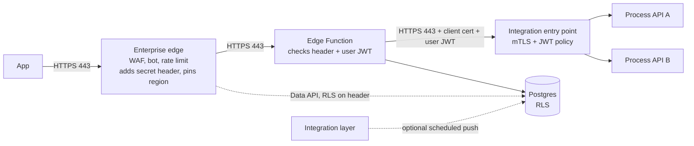

# Supabase BFF behind an enterprise edge, calling a private integration layer - Spec

**Goal:** a reference design for an app backend on hosted Supabase that sits
behind the enterprise's own edge and calls the enterprise's integration layer
(an iPaaS on a non-AWS cloud) without a private network link.
**Workflow:** design-first (the network constraints are fixed by the platform;
the requirements are what the design can guarantee).
**Non-goals:** private connectivity from Supabase to a non-AWS network (not
available: PrivateLink is AWS-only and database-inbound only); client-side app
hardening beyond the edge; commercial plan choice; the integration layer's own
internal design.

Evidence: `experiments/edge-private-flow/RUNLOG.md` (runs 1-2) and
`docs/research/2026-11-23-edge-private-api.md`. Requirement IDs map to the
probe ids that test them.

## Requirements

### R1: authenticated outbound calls, no network trust
**Story:** As the integration team, I want every call from Supabase to prove
who it is, so that the entry point can sit on the public internet.
**Acceptance criteria:**
- WHEN an Edge Function calls the integration entry point, THE SYSTEM SHALL present an X.509 v3 client certificate (RSA or named-curve EC) [run 1 F2/F3, run 2 GW1].
- IF a request reaches the entry point without a client certificate, THEN THE SYSTEM SHALL refuse it before any API logic runs [run 2 GW1 "jwt, no cert"].
- IF the certificate is signed by a CA the entry point does not trust, THEN THE SYSTEM SHALL refuse it [run 2 GW1 "wrong-CA cert"; run 3 OWN1 against an entry point trusting only the enterprise's own CA].
- WHEN the client certificate secret changes, THE SYSTEM SHALL present the new certificate without a redeploy (seen by 10 s in run 3 ROT, one post-change sample per arm).
- THE SYSTEM SHALL NOT depend on the Supabase egress IP address (not fixed: three addresses seen in one day, 2026-11-23).

### R2: end-user identity reaches the integration layer
**Story:** As the integration team, I want to know which app user a call is
for, so that process APIs can authorise per user.
**Acceptance criteria:**
- WHEN the function calls the entry point, THE SYSTEM SHALL forward the user's Supabase access token as a Bearer token [run 1 F4, run 2 GW1].
- WHEN the entry point receives a token, THE SYSTEM SHALL validate signature, issuer `https://<ref>.supabase.co/auth/v1`, audience `authenticated` and expiry against `/auth/v1/.well-known/jwks.json` [run 1 F4].
- IF the token is missing or invalid, THEN THE SYSTEM SHALL answer 401 [run 2 GW1 "cert, no jwt"].
- WHERE the project still signs with the legacy HS256 secret, THE SYSTEM SHALL first move to an asymmetric signing key (no public JWKS entry otherwise).

### R3: one entry point in front of many process APIs
**Story:** As the integration team, I want one hardened entry point, so that
each internal process API does not need its own public endpoint.
**Acceptance criteria:**
- THE SYSTEM SHALL route several process APIs behind one hostname that enforces R1 and R2 once [run 2 GW1 orders + rates].

### R4: the enterprise edge is the only useful path for app traffic
**Story:** As the security reviewer, I want app traffic to pass the
enterprise WAF, so that bot and rate controls apply.
**Acceptance criteria:**
- IF an Edge Function is called without the edge's shared-secret header, THEN THE SYSTEM SHALL answer 403 before any work [run 1 G1/G2].
- IF the Data API is called without the edge's header, THEN THE SYSTEM SHALL return no rows (RLS on `request.headers`) [run 1 D2-D4].
- THE SYSTEM SHALL document that Auth and Storage stay reachable on `<ref>.supabase.co` and are protected by CAPTCHA, rate limits and Storage RLS instead [run 1 O1/O2].
- THE SYSTEM SHALL NOT rely on a header a direct caller can set to the same value (checked in run 2 H4 for `cf-worker` and address headers).

### R5: functions run next to the data
**Story:** As the app owner, I want function execution in the project region,
so that calls to Postgres and to the integration layer are not routed abroad.
**Acceptance criteria:**
- WHEN the edge forwards a function call, THE SYSTEM SHALL pin the region with `x-region` and `forceFunctionRegion` [run 1 R1-R3; run 3 ABR: callers in us-east-1 and eu-central-1 ran in ap-southeast-1 through the edge and in their own region without it].
- THE SYSTEM SHALL document that a pinned call is not re-routed during a regional outage.

### R6: bounded failure
**Story:** As the app owner, I want a slow integration layer to fail fast.
**Acceptance criteria:**
- WHEN the function calls the entry point, THE SYSTEM SHALL apply a timeout (15 s in the lab relay) and return an error rather than wait for the 150 s request idle limit.
- IF a client certificate is malformed or unsupported, THEN THE SYSTEM SHALL return an error for that request and keep serving others [run 2 V1/V2].

## Design

Components:

- **Enterprise edge** (lab: Cloudflare Worker). Adds `x-gw-secret` from its
  own secret store, sets `x-region` + `forceFunctionRegion`, forwards
  `apikey` and `Authorization`. All users reach Supabase from the edge's
  address; Auth per-IP rate limits need `Sb-Forwarded-For` (run 2 H1-H3).
- **Edge Function**. Deployed with verify_jwt off; checks the header, then
  `getClaims` on a module-scope client (JWKS cache survives requests). One
  module-scope `HttpClient` per certificate (`Deno.createHttpClient({cert,
  key})`); cert and key as function secrets (multi-line PEM works through the
  Management API). Timeout on every outbound call.
- **Integration entry point** (lab: a Worker behind Cloudflare mTLS with the
  Cloudflare-managed CA). On an iPaaS this is an ingress TLS truststore plus a
  JWT validation policy; on a cloud, its API gateway in front with JWT
  validation. Variant: Cloudflare Access service token instead of mTLS
  (run 2 SV1).
- **Data API gate**. SECURITY DEFINER `via_front()` compares the header to a
  value in a private table; RLS policies call it.

### Decision log

| Decision | Why | Rejected (and why) |
|---|---|---|
| mTLS + forwarded JWT at the entry point | proves both the caller (cert) and the user (token); no network trust | IP allowlist: egress not fixed, iPaaS firewalls may not take a custom CIDR, header-based allowlists are spoofable |
| one entry point for many process APIs | R1/R2 enforced once | one public endpoint per process API |
| RLS on `request.headers` for the Data API | measured to work on hosted | `db_pre_request` (does not fire on hosted, L09/S16) |
| module-scope HttpClient and supabase-js client | reuses TLS sessions and the JWKS cache | per-request clients (handshake + JWKS fetch every call) |
| Access service token as an alternative | free-plan, no PKI to run | weaker identity: a shared secret, not a per-caller certificate |

### Testing strategy

`experiments/edge-private-flow`: `make all` (run 1) and `make run2`. Every
acceptance criterion above names its probe row.

## Open questions

- Does the iPaaS entry point refuse a request with no client certificate
  (vendor docs disagree)? Default: test it on the tenant before relying on it.
- `cf-worker` as an edge signal: answered by run 2 H2/H3 - it reads
  `supabase.co` on every request, so it cannot be used; the secret header stays.
- Enterprise zone proxied in front of a Supabase custom domain (O2O):
  untested, WebSockets marked unsupported by Cloudflare. Default: call the
  custom domain or the edge Worker, not O2O.
